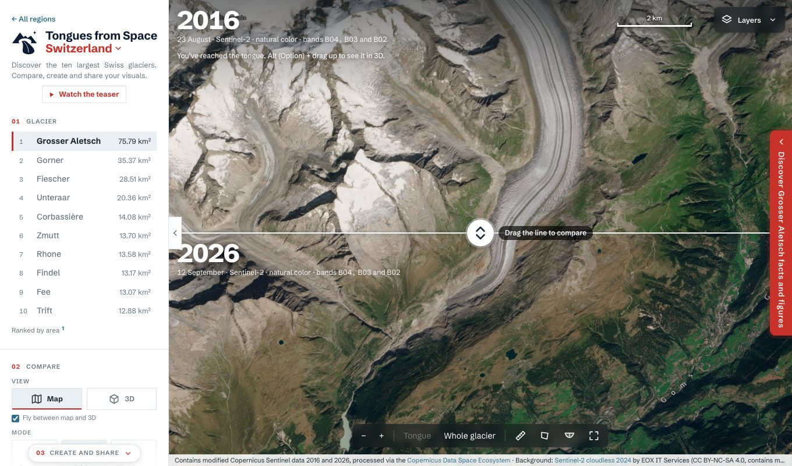
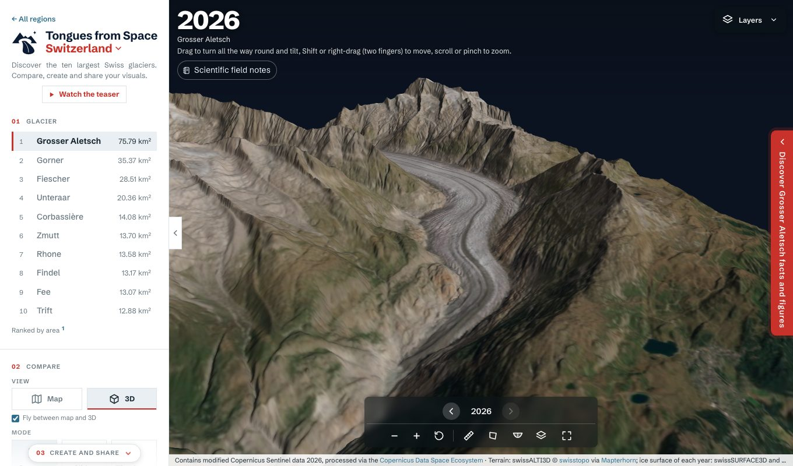

# Tongues from Space

**See how glaciers change from orbit.** The tongues of the ten largest Swiss glaciers (and, as a second region, Franz Josef Glacier in New Zealand) in real Sentinel-2 satellite images, one clear late-summer scene per year since 2016, next to published glacier figures. Slide through the years, fly over the ice in 3D, compare a glacier with your own town, and make a picture or a video to share.

**Live site: https://tonguesfromspace.org/**

A glacier ends in its tongue, the lowest stretch of ice, where it melts the most. That is where change is easiest to see: every summer the tip pulls back and leaves bare rock, a lake or a new valley floor. This project puts those pictures first, with the figures and what the melted ice means in water beside them.

## What you can do

**On the front page** ([tonguesfromspace.org](https://tonguesfromspace.org/)) watch the tour, search for a glacier in any language or pick one on the map, and read why the project exists and what is measured and what is computed.

**In English, German and French:** the language is in the address (`/de/…`, `/fr/…`) and every page has a switch.

**In the Explorer** (one page per region: `/switzerland/` and `/new-zealand/`; every Swiss glacier also has its own address, `/switzerland/<glacier>/`):

1. **Choose a glacier** from the list or the map.
2. **Compare** the years:
   - *One year*, *Compare* (a slider between two years) and *Timelapse*, in three colour styles, plus the newest clear scene ("Latest"). Older pictures (aerial photographs, Landsat) go further back where the data exists.
   - *3D view* of the tongue with the picture of any year draped over the terrain, historic photographs placed where they were taken, the ice surface of each year where the data allows, and a thickness cross-section you can draw on the map and fly into.
   - *Pin tool*: drop a pin on the map or in 3D and a card shows the ice surface of every year there, the ice left above the modelled bed, the ice speed and the outlines at that place (with a CSV download).
   - *Map layers*: outlines, aerial pictures, special swisstopo survey flights, hiking trails and where the ice front is in view from them, radar ice thickness, ice speed, Street View.
   - *Glacier figures*: area, length change, thickness, volume and the water the ice stores, each with its source.
3. **Create and share**: a picture (JPG or PNG) or an MP4 animation (16:9, 9:16, 4:5) made in your browser, either of the map or of the 3D flight; a link that keeps the view; an `<iframe>` to embed it in your own page; and an optional, moderated public gallery.

**On the Size page** ([/size](https://tonguesfromspace.org/size)), *How big are glaciers?*: pick two glaciers and compare them.
- **Area (2D):** the outlines on a map, laid over a town or city you choose, to feel the size.
- **Volume (3D):** the ice of each glacier as a block (or a ball) of its stated volume, dropped onto that city or left on its own glacier. You can pick the blocks up and throw them, see how long they would take to melt at their recent average loss, and show all ten glaciers at once.
- Pictures, animations, links and embeds work as in the Explorer. Values that are calculated here (edge of the block, footprint, years to melt) are labelled as computed.

**The Gallery** ([/gallery](https://tonguesfromspace.org/gallery)) shows pictures and animations that visitors shared, filterable by glacier, year and type.

**The field notes** ([/provenance](https://tonguesfromspace.org/provenance)) explain how the yearly 3D ice surfaces and the special-flight layers were made, glacier by glacier, with their sources and uncertainties.

It works on phones too (two fingers move the map; the viewer pins to the top while you read).

## What is published

**Switzerland** is open: the ten largest glaciers by area in the newest GLAMOS inventory. **New Zealand** is open with Franz Josef Glacier (Kā Roimata o Hine Hukatere); it shows the same cards and layers as Switzerland, with a dash where a region has no data. Iceland, Norway and Svalbard are in the making and not yet public.

## Where the numbers come from

The pictures are real satellite images with their date; the project never paints in or generates ice. Figures (GLAMOS, swisstopo, ITS_LIVE and others) are shown as the source states them, each with a note; anything calculated here is marked as computed, and where the record has gaps (for example Landsat 7 stripes or years without a measured surface) the page says what was estimated. Full list and licences: [docs/SOURCES.md](docs/SOURCES.md). Because some data is licensed for non-commercial use only, the site is non-commercial.

Built by [Jochem Braakhekke](https://github.com/braakhekke) to increase glacial awareness.

## Feedback

Found a mistake, have an idea, a translation or a sourced glacier text to offer? Please open an issue.

## Licences

- **Code:** [MIT](LICENSE).
- **Texts** written for this project (glacier descriptions, About chapters, this README): [CC BY 4.0](https://creativecommons.org/licenses/by/4.0/), credit Jochem Braakhekke. The pictures in `images/` are not covered: please ask first.
- **Data and fonts** keep their own licences, listed in [docs/SOURCES.md](docs/SOURCES.md). Because the GLAMOS length-change, volume-change and Swiss-wide volume data and the EOX background are licensed for non-commercial use, **the site as published is non-commercial.**

## Credits

Historic photographs in the 3D view: ETH Library, Bildarchiv, [CC BY-SA 4.0](https://creativecommons.org/licenses/by-sa/4.0/); where each camera stood was worked out by volunteers on [Smapshot](https://smapshot.heig-vd.ch) (HEIG-VD). Created by Jochem Braakhekke. See also [For Your Ice](https://foryourice.org/). Built with [Leaflet](https://leafletjs.com/).
