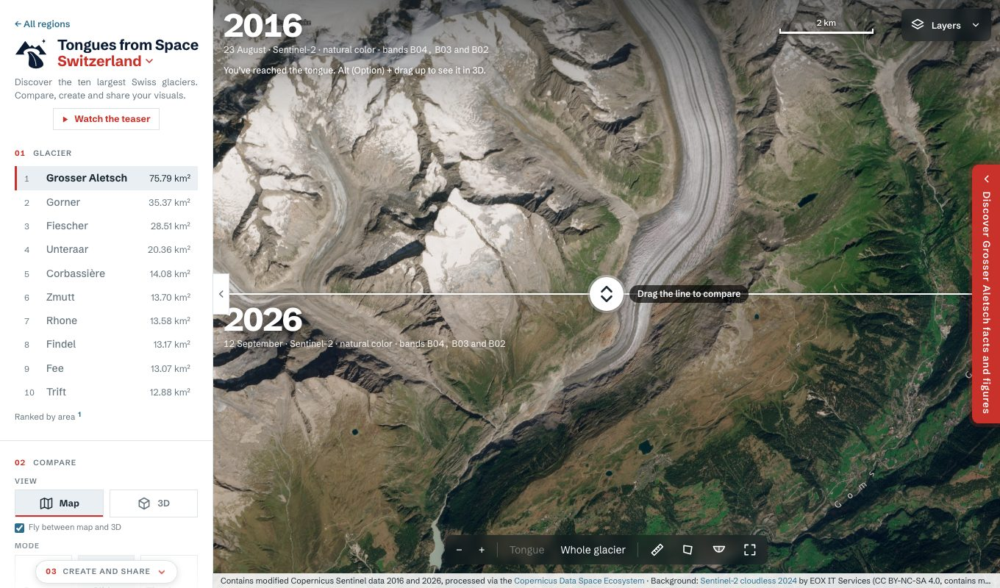
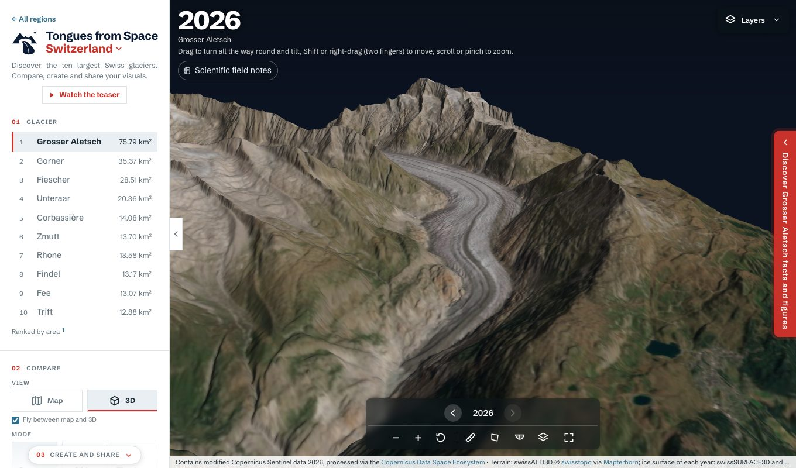

# Tongues from Space

**The tongues of the largest glaciers in Sentinel-2 imagery: one clear late-summer scene per year, with glacier figures, a compare slider, a timelapse, a 3D view with thickness cross-sections, and image and video export.**

**What is published.** Switzerland is open: the ten largest glaciers by area in the newest GLAMOS inventory (ranked by `scripts/build_outlines.py`). Iceland (twelve outlets of Vatnajökull and the ten largest glaciers outside it), Norway (ten) and Svalbard (ten) are built but stay off the public site until the repository variables `PUBLISH_ICELAND` and `PUBLISH_NORWAY` are set to `1` (see [docs/SETUP.md](docs/SETUP.md)); they are in the making. The counts are of the data files in `data/` today.

Live site: https://tonguesfromspace.org/

A glacier ends in its tongue, the lowest stretch of ice, where it melts the most. That is where change is easiest to see: every summer the tip pulls back and leaves bare rock, a lake or a new valley floor. This project puts those pictures first, next to the figures and what the melted ice means in water.

Built by [Jochem Braakhekke](https://github.com/braakhekke) to increase glacial awareness. It is open source: **you are welcome to help, or to make an explorer like it for glaciers in your own region** (see [docs/SETUP.md](docs/SETUP.md)).





## What it does

- **Satellite images:** for every glacier and year the clearest late-summer Sentinel-2 scene, scored for cloud and snow.
- **One year, Compare, Timelapse**, three colour styles, and the newest clear scene ("Latest").
- **3D view** of the tongue with the picture of any year draped over the terrain, historic photographs, yearly ice surfaces where the data allows, and a thickness cross-section you can draw on the map and fly into.
- **Glacier figures:** area, length change, thickness, volume and the water the ice stores, each with its source.
- **Map layers:** outlines, aerial pictures, hiking trails and where the ice front is in view, radar thickness, ice speed, Street View.
- **Export and share:** image or MP4 (16:9, 9:16, 4:5) made in the browser; a link keeps the state; an optional moderated gallery.

Everything the page does runs in the visitor's browser. The only server code is one Cloudflare Worker (static site, Copernicus relay, gallery).

## How the code is laid out

```
index.html  home.html  gallery.html  size.html     the pages (play.html: game sheets; provenance.html: the field notes of the 3D view)
css/                                               tokens.css (colours, type), style.css (the explorer, size page), home.css, pages.css, play.css
js/main.js                                         the entry: imports the sections in order
js/regions.js  js/00-regions.js                    every region, once (classic scripts, run first)
js/01-data … 14-streetview.js                      the explorer, one ES module per section
js/wire.js  js/devtools.js                         calls up the load order; test/debug hook
data/                                              data the pages load (generated by scripts/ or hand-made)
scripts/                                           the build (build_site.py), data builders and the local server (serve.py); parked/ = scripts nothing uses today
worker/                                            the Cloudflare Worker: static site, relay for Copernicus requests, gallery
shared/                                            schema, season rule, geometry and request builder shared by the Worker and the tools
tests/                                             browser tests (Playwright), Worker tests, health check
docs/                                              REFERENCE (every file and data set), SETUP (publishing a copy), SOURCES (data and licences)
```

The tools used to onboard new glaciers (the walkthrough, review pages, source ledgers) and the records they keep are not part of this repository.

**Addresses.** On the public site `/` is the region picker (`home.html`: a world map and a list) and every published region has its own page: `/switzerland/`, and, when switched on, `/iceland/`, `/norway/` and `/svalbard/` (the older Icelandic addresses `/iceland/vatnajokull/` and `/iceland/rest/` open Iceland too). All of them are copies of `index.html` made by `scripts/build_site.py`, one per region in `js/regions.js` (`path`, `pathAlso`). Old links like `/#g=aletsch&m=compare` are sent to the right region page. With `scripts/serve.py` `/` is the picker and `/index.html` the explorer (without Copernicus credentials the pages still load, just without satellite pictures). Every page has an "← All regions" link back to the picker (`js/home-link.js`). Colours and the typeface are in one file, `css/tokens.css`.

**Generated files.** `data/boxes.js`, `data/scenes.json` and `worker/glacier-index.json` are generated from the owner's records of each glacier and are committed; do not edit them by hand.

Three rules keep the code changeable (details in [docs/REFERENCE.md](docs/REFERENCE.md)):

1. **A file imports from files with a lower number.** Going up the order, use `wire.name`. There are no import cycles, so the files load in the order of their numbers.
2. **A region is data.** What a region has or lacks is a flag in its record in `js/00-regions.js` (`features`), never a test of its id.
3. **Facts are copied, not made up.** Every figure about a glacier has a source and is shown as the source states it.

Data flow: the browser asks the relay for scene scores and pictures; the relay (Worker, or `scripts/serve.py` locally) holds the Copernicus login, validates each request and caches the answer. Glacier data is built ahead of time by the scripts in `scripts/` and committed or generated by the monthly GitHub Action.

## Run it on your computer

You need Python 3, Node.js 22 or newer, and a free [Copernicus Data Space](https://dataspace.copernicus.eu/) account for the satellite pictures.

1. In the [CDSE dashboard](https://shapps.dataspace.copernicus.eu/dashboard/) open *User settings → OAuth clients* and create a client.
2. In the repository folder:

   ```bash
   npm ci                      # TypeScript for the checks, esbuild for the build
   python3 scripts/serve.py    # asks for the client ID and secret; then open http://localhost:8000
   ```

   It also reads `CDSE_CLIENT_ID` and `CDSE_CLIENT_SECRET`, or `scripts/.cdse-credentials` (git-ignored). Without credentials it still serves the pages, without satellite pictures.

## Check and test

```bash
python3 scripts/check_syntax.py   # syntax of every page, script, Worker and data file
python3 scripts/check_types.py    # names, properties and argument counts
pip install -r tests/requirements.txt && python3 -m playwright install chromium
python3 -m unittest discover -s tests -v    # the page in headless Chromium, the Worker with a fake Copernicus
python3 scripts/build_site.py _site && TFS_SITE_DIR=_site python3 -m unittest tests.test_site -v    # the same on the built site
```

The workflows run the same before every deploy (`.github/workflows/`): a failure stops the deploy.

## Add a glacier or a region

New glaciers are onboarded by the owner with local tools that are not in this repository. If you want one added or want to adapt the project to another region, open an issue; [docs/SETUP.md](docs/SETUP.md) describes publishing a copy and adding a region.

## More documentation

| File | What |
|---|---|
| [docs/REFERENCE.md](docs/REFERENCE.md) | Every file and data set, the map of `js/`, the data flow |
| [docs/SETUP.md](docs/SETUP.md) | Publishing a copy, Street View, gallery, another region |
| [docs/SOURCES.md](docs/SOURCES.md) | Data sources and their licences |

## Contributing

Bug reports, ideas, translations, sourced glacier texts and code are welcome; please open an issue first for larger changes.

- **Only documented facts, exactly as the source states them:** rounding to at most 2 decimals is allowed, but no unit conversion, midpoints or respelling of an external figure; if you cannot read the source, leave the figure out; a value you calculate is labelled as computed. If the origin of a name or a number is unknown, say so.
- **Glaciological years** are named after the year they end in (2017 = October 2016 to September 2017).
- **UI text in English;** red accent `#C8322A` for loss, blue for ice and water, Schibsted Grotesk.
- **Keep it calm and compact:** little text, details behind small "i" buttons.
- **No CSS or SVG filters on page elements for image effects** (Safari on iPhone ignores them); process pixels in a canvas.
- After changing how scenes are scored or rendered, raise `CDSE.version` (`js/03-imagery.js`) so browsers drop old images.

## Licences

- **Code** (`js/`, `worker/`, `scripts/`, the workflows): [MIT](LICENSE).
- **Texts** written for this project (glacier descriptions, About chapters, this README): [CC BY 4.0](https://creativecommons.org/licenses/by/4.0/), credit Jochem Braakhekke. The pictures in `images/` are not covered: please ask first.
- **Data and fonts** keep their own licences, listed in [docs/SOURCES.md](docs/SOURCES.md). Because the GLAMOS length-change, volume-change and Swiss-wide volume data and the EOX background are licensed for non-commercial use, **the site as published is non-commercial.**

## Credits

Historic photographs in the 3D view: ETH Library, Bildarchiv, [CC BY-SA 4.0](https://creativecommons.org/licenses/by-sa/4.0/); where each camera stood was worked out by volunteers on [Smapshot](https://smapshot.heig-vd.ch) (HEIG-VD). Created by Jochem Braakhekke. See also [For Your Ice](https://foryourice.org/). Built with [Leaflet](https://leafletjs.com/).
