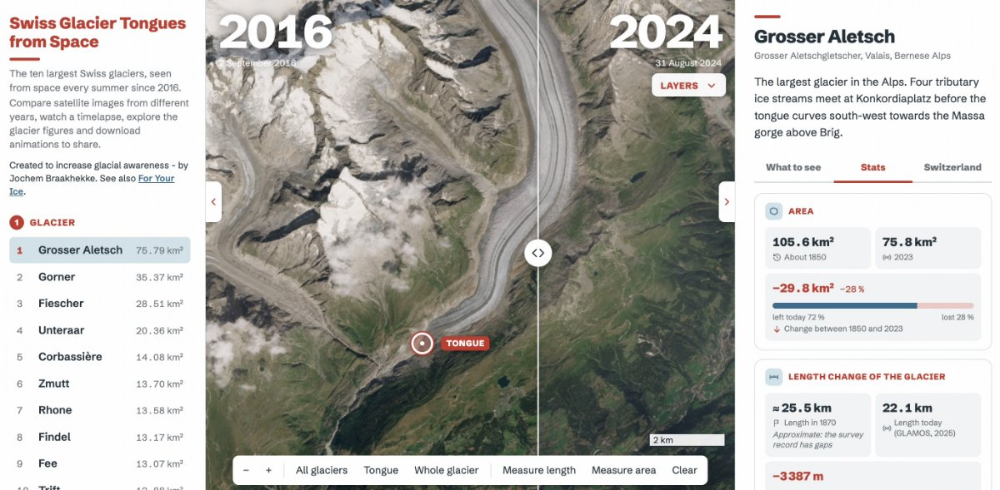

# Tongues from Space - Switzerland

**The ten largest Swiss glaciers: satellite images since 2016, aerial photos, 3D terrain and historic photographs. Compare different years, create timelapses, explore the glacier figures and download pictures and animations to share.**

Live site: https://tonguesfromspace.org/

A glacier ends in its tongue, the lowest stretch of ice, where it melts the most. That is where change is easiest to see: every summer the tip pulls back and leaves bare rock, a lake or a new valley floor. This project puts those pictures first, next to the glacier figures and what the melted ice means in water, because a before-and-after image is understood at once and remembered.

It is built by [Jochem Braakhekke](https://github.com/braakhekke) to increase glacial awareness, and it is open source: **you are welcome to help build it, or to make a dashboard like it for glaciers in your own country or region.** See [Contributing](#contributing) and [Make your own version](#make-your-own-version-for-another-region).



## What it does

- **Satellite images:** for every glacier and year, the clearest late-summer Sentinel-2 scene (best September scene, otherwise August, otherwise July), scored for cloud and snow cover.
- **One year, Compare, Timelapse:** look at a single year, swipe between two years, or play a range of years.
- **Colours:** Natural, False 1 (infrared) and False 2 (snow and ice in red; experimental), each with a plain-language note.
- **Latest image:** the newest clear scene of the last 60 days, next to the yearly pictures.
- **3D view:** the tongue and the glacier above it as a 3D landscape (swissALTI3D terrain), with the satellite picture of any year draped over it, a year slider or a before/after split, and the ice surface following the year. Image and video download from the 3D view too.
- **Glacier figures:** area since 1850, length and length change from the first survey, thickness and volume change from the GLAMOS volume surveys, the thickest ice measured by radar, and the ice and water stored in each glacier (litres, Olympic pools, Lake Zurich). A map layer shows the radar thickness measurements, and another where on the hiking trails the tongue is in view.
- **Switzerland as a whole:** ice left since 2016, ice lost per year, and how much water that is.
- **Map tools:** outlines of 1850 and 2023, a tongue indication, measuring of lengths and areas, background layers.
- **Download image and animation:** one picture, a timelapse or a slider as JPEG or MP4 for Instagram, TikTok and others (9:16 following Instagram's safe zones, or 4:5). Made in the browser.
- **Share:** a link to the current glacier, mode and years.

Everything the page does runs in the visitor's browser. There is no database and no build step for the code: the site is `index.html`, `css/style.css` and `js/*.js` plus data files that are generated ahead of time.

## Requirements

| To | You need |
|---|---|
| Use the site | A modern browser. Nothing to install. |
| [Run it on your computer](#run-it-on-your-computer) | Python 3 (standard library only) and a free [Copernicus Data Space](https://dataspace.copernicus.eu/) account for the satellite images. |
| Run the checks and tests | Node.js (for the syntax and type checks; on macOS `jsc` works for the syntax check), and `pip install -r tests/requirements.txt` followed by `python3 -m playwright install chromium` for the browser tests. |
| Record the teaser film again | `ffmpeg` (or `imageio-ffmpeg`) and Playwright, see `scripts/make_teaser.py`. |
| [Publish your own copy](#publish-your-own-copy) | A GitHub account (Pages and Actions) and a free Cloudflare account for the Worker; the optional [gallery](#gallery-optional) also needs R2 and Turnstile. |

## How it works

```
 visitor's browser ──► index.html + data/glaciers.js              (Cloudflare Worker, static assets)
        │
        └─ satellite requests ──► relay ──► Copernicus Data Space (Sentinel Hub APIs)
                                   │
              Cloudflare Worker (public site)  or  scripts/serve.py (your computer)
```

- **Scene choice:** one Statistical API request per glacier and summer scores every Sentinel-2 L2A acquisition for cloud and snow (scene classification). The best day is then rendered from Sentinel-2 L1C with the Copernicus Browser true colour process.
- **Why a relay:** Copernicus needs a login, and browsers cannot log in to it directly. The relay holds one OAuth client, forwards only the two request types the dashboard makes, and caches the answers. Visitors need no account.
- **Glacier data:** `scripts/build_outlines.py` downloads the Swiss Glacier Inventories, the length-change and volume-change series, the Swiss-wide volume series and the radar ice thickness from GLAMOS, ranks the glaciers, finds each tongue tip, and writes `glaciers.js` and `thickness.js` (the radar points, loaded only when that layer is switched on). A GitHub Action runs it monthly.
- **Caching:** the browser keeps the scenes and images it has fetched in IndexedDB (images capped at 150 MB); the Worker keeps answers in Cloudflare KV.

| Path | What |
|---|---|
| `index.html`, `css/style.css`, `js/*.js` | The whole dashboard (markup, CSS and JavaScript in plain scripts, Leaflet from a CDN) |
| `gallery.html`, `css/pages.css` | Public gallery of shared pictures and animations |
| `data/glaciers.js`, `data/thickness.js` | Generated by `build_outlines.py` (GitHub Action, monthly); do not edit by hand |
| `data/scenes.json` | The scene (day and orbit) chosen per glacier and year with `scripts/tools/pick-scenes.html`; years not listed are chosen automatically |
| `data/cloudmasks.json` | Areas used to judge cloud for the Latest image; made by `scripts/make_cloud_masks.py` |
| `data/demchange/`, `data/terrain/`, `data/sightline.js`, `data/photos.json` | 3D view data (ice-surface change, baked terrain per glacier, trail line of sight). Made by hand with the scripts below and committed; the deploy copies them |
| `scripts/build_outlines.py` | Downloads GLAMOS data, writes `glaciers.js` and `thickness.js` |
| `scripts/build_dem_change.py`, `build_terrain_bundle.py`, `build_sightline.py`, `make_cloud_masks.py` | Make the data files above. All Python standard library only; the first three download swissALTI3D tiles into `scripts/.dem-cache` (git-ignored, about 2 GB) |
| `scripts/serve.py` | Local web server plus Copernicus relay for development |
| `worker/` | Cloudflare Worker (`worker.js`, optional `wrangler.toml`): the public relay and the gallery back end |
| `scripts/tools/` | Local helpers: `pick-scenes.html` (choose scenes), `warm-up.html` (fill the relay cache after a deploy), `gallery-admin.html` (moderation). Run with `python3 -m http.server 8000`; they spend Copernicus requests |
| `.github/workflows/deploy.yml` | Builds the data, tests it and deploys the site and Worker to Cloudflare |
| `fonts/`, `images/` | Self-hosted font (SIL OFL) and the pictures used by the page |
| `CLAUDE.md` | Notes on the code for developers and AI assistants |

## Run it on your computer

You need Python 3 and a free Copernicus Data Space account (see [Requirements](#requirements)).

1. In the [CDSE dashboard](https://shapps.dataspace.copernicus.eu/dashboard/) open *User settings → OAuth clients* and create a client. Note its ID and secret.
2. In the repository folder run:

   ```bash
   python3 scripts/serve.py        # then open http://localhost:8000
   ```

   It asks for the client ID and secret (or reads `CDSE_CLIENT_ID` and `CDSE_CLIENT_SECRET`, or `scripts/.cdse-credentials`, which is git-ignored).
3. To refresh the glacier data: `python3 scripts/build_outlines.py`. The 3D data (`build_dem_change.py`, then `build_terrain_bundle.py`; `build_sightline.py` for the trails) and `make_cloud_masks.py` are run by hand when needed and their output committed.

Use `http://localhost:8000` and not another address if you want to use a deployed Worker instead: the Worker only accepts the origins it is configured with.

## Publish your own copy

1. **Cloudflare:** fork the repository; under *Settings → Secrets and variables → Actions* set the secrets `CLOUDFLARE_API_TOKEN` (Workers edit rights) and `CLOUDFLARE_ACCOUNT_ID` and the variables `CF_KV_CACHE_ID` and `CF_R2_GALLERY_BUCKET`, then run the workflow *Build data and deploy*. One Worker serves the site and the relay (`worker/wrangler.toml`).
2. **Relay (free):** create a Cloudflare Worker from `worker/worker.js`; add your OAuth client as the secrets `CDSE_CLIENT_ID` and `CDSE_CLIENT_SECRET`, a text variable `ALLOWED_ORIGINS` (your site address, plus `http://localhost:8000` for development), and optionally a KV namespace bound as `CACHE`. Check `…/cdse/ping`.
3. **Connect:** in the GitHub repository add the variable `CDSE_RELAY_URL` (the Worker address) and run the workflow again. Optionally run `scripts/tools/warm-up.html` locally afterwards to fill the relay cache.

For a strict limit against misuse, add a Cloudflare rate-limiting rule for the path `/cdse/`. Please check that the [Copernicus terms](https://dataspace.copernicus.eu) allow serving a public website from one account before you launch.

## Street View panoramas (optional)

The map layer *Street View* shows seven panoramas of the Aletsch Glacier (`data/streetview.json`) in Google's own viewer. It needs a public **Maps Embed API** key (the API is free and unlimited):

1. In the [Google Cloud console](https://console.cloud.google.com) create a project with billing enabled, and enable **Maps Embed API**.
2. Create an API key, restrict it to the website addresses `https://<your site>/*` and `http://localhost:8000/*`, and to the API *Maps Embed API* only.
3. Add the key as the repository variable `STREETVIEW_EMBED_KEY` and run the workflow again. Locally, add `streetViewKey: "…"` to `config.js`. Without the key the layer is not offered.

To choose other panoramas, put a separate key (restricted to your IP address and to *Street View Static API*; its metadata requests are free) in `scripts/.google-key` and run `python3 scripts/build_streetview.py scan`, then `rank --visitors`, then `review` (see the docstring). Google forbids storing Street View content except panorama ids, so the scan results stay local (git-ignored).

## Gallery (optional)

Visitors can share a finished picture or animation (button *Share it in the gallery* after a download). Uploads wait in a queue until you approve them; `gallery.html` shows only approved items, filterable by glacier, year, type and band combination.

Set up in Cloudflare (the Worker needs to be pasted again afterwards):
1. **R2:** create a bucket, bind it to the Worker as `GALLERY`. Add a lifecycle rule on the prefix `pending/` that deletes objects after 14 days.
2. **Turnstile:** create a widget for your site's domain. Add the secret key as Worker secret `TURNSTILE_SECRET` and the site key as text variable `TURNSTILE_SITEKEY`.
3. **Admin token:** add a Worker secret `GALLERY_ADMIN_TOKEN` (at least 20 random characters).
4. **Rate limit:** add a Cloudflare rate-limiting rule for `/gallery/submit` (for example 5 requests per hour per IP).
5. **Moderate:** run `python3 -m http.server 8000` and open `http://localhost:8000/scripts/tools/gallery-admin.html`, enter the token, approve or reject.

What the Worker enforces on every upload: Turnstile check; at most 15 MB (video) or 4 MB (picture); the real file type (JPEG or H.264 MP4) and the exact pixel size of the three export formats; a fixed list of details (glacier, years, type, format, colours, optional nickname); at most 200 items waiting; one copy of each file; 4 uploads per hour per address (per Worker instance). Pending files are never served. Approved files are served with `nosniff` and a sandboxing content-security-policy. The page shows all text via `textContent`.

## Make your own version for another region

The imagery part works anywhere Sentinel-2 does. The Swiss parts are the data sources and a few limits. To adapt it:

1. **Pick your glaciers and a national or regional inventory.** Everything Swiss is in a few places, so start with these files: `build_outlines.py`, the 3D scripts (swissALTI3D, swissNAMES3D, swissTLM3D; use your national elevation model, or drop the 3D view and trails) and the swisstopo layers in `index.html`. Replace the GLAMOS downloads in `scripts/build_outlines.py` with your inventory (outlines and areas), and with a length-change series if one exists for your region. Many countries publish inventories; the global Randolph Glacier Inventory and GLIMS are alternatives.
2. **Area limits:** in `worker/worker.js` change the bounding box `SWISS` to your region. In `index.html` update `SWISS_VIEW`, the built-in glacier list `DEFAULTS` and the `GLACIER_INFO` texts. Only write facts you can source.
3. **Season:** the page looks for the clearest scene between 1 July and 20 September (`CDSE.months`, `LAST_DAY`). In the southern hemisphere or the tropics choose the end of your melt season instead, and change the matching date checks in the Worker.
4. **National figures:** the Switzerland tab uses yearly ice loss and total ice volume from GLAMOS and SCNAT (`VOLUME_LOSS`, `ICE_2024`). Replace them with your own source or remove the tab.
5. **Regenerate the data files:** run `make_cloud_masks.py`, pick scenes with `scripts/tools/pick-scenes.html` (optional) and, for 3D, the three terrain scripts.
6. **Texts and credits:** the About chapter, sources list and credits line must list your data.

Open an issue if you get stuck. I would be glad to hear about a dashboard for another region and to link to it.

## Contributing

Contributions are welcome: bug reports, ideas, translations, glacier texts with sources, or code. Please open an issue first for larger changes. A few ground rules:

- **Only documented facts.** Every figure and text about a glacier needs a source. If the origin of a name or a number is unknown, say so.
- **Keep it calm and compact:** little text, details behind small "i" buttons or in the About chapter.
- **No CSS or SVG filters on page elements for image effects** (Safari on iPhone ignores them); process pixels in a canvas.
- **After changing how scenes are scored or rendered,** raise `CDSE.version` in `index.html` so browsers drop old images.
- Test locally with `scripts/serve.py`. `CLAUDE.md` describes the structure of the code (`js/`) and a test checklist; `python3 -m unittest discover -s tests -v` runs the automatic tests.

Things that would help: more glaciers and regions, translations, verified glacier texts, and testing on real iPhones and in Safari.

## Data sources and licences

- **Imagery:** Copernicus Sentinel-2 L1C and L2A via the Copernicus Data Space Ecosystem. Contains modified Copernicus Sentinel data. Free for any use with attribution.
- **Glacier areas and outlines:** GLAMOS Swiss Glacier Inventories 1850, 1973 and 2023, CC BY 4.0.
- **Length change:** GLAMOS (2025), Swiss Glacier Length Change, release 2025, doi:10.18750/lengthchange.2025.r2025. Free for scientific and **non-commercial** use with the source indicated. The length today is read from the GLAMOS figure [lc_stat_frequency](https://doi.glamos.ch/figures/lc_stat_frequency.pdf).
- **Volume change:** GLAMOS (2025), Swiss Glacier Volume Change, release 2025, doi:10.18750/volumechange.2025.r2025. Geodetic volume change of each glacier from elevation models; the file says: free for scientific and **non-commercial** use with the source indicated (the landing page says CC BY 4.0).
- **Yearly mass balance:** GLAMOS (2025), Swiss Glacier Mass Balance, release 2025, doi:10.18750/massbalance.2025.r2025. Direct glacier-wide balance of about 40 glaciers (four of the ten: Aletsch, Rhone, Corbassière, Findel); the file says non-commercial use.
- **Swiss-wide volume:** GLAMOS (2025), Swisswide Glacier Mass Balance, release 2025, doi:10.18750/massbalance.swisswide.2025.r2025. Yearly volume of all Swiss glaciers; the same non-commercial wording in the file.
- **Radar ice thickness:** GLAMOS (2020), Swiss Glacier Ice Thickness, release 2020, doi:10.18750/icethickness.2020.r2020 (CC BY 4.0). Ground-penetrating radar points, thinned to one mean per 50 m cell.
- **Street View panoramas (Aletsch):** © Google, photographed by Google or by visitors (the contributor is named in the panel). They are shown in Google's own viewer (Maps Embed API, free); only the panorama ids are stored (`data/streetview.json`), which Google allows. Without the key `STREETVIEW_EMBED_KEY` (see below) the layer is not offered.
- **Yearly volume loss:** GLAMOS and the Swiss Academy of Sciences (SCNAT) annual glacier reports.
- **Ice thickness and volume per glacier:** Grab et al. (2021), Journal of Glaciology 67(266), via the swisstopo map service.
- **Water use:** SVGW water statistics.
- **Background:** Sentinel-2 cloudless 2024 by EOX IT Services GmbH ([s2maps.eu](https://s2maps.eu)), CC BY-NC-SA 4.0. **Base map and place labels:** © OpenStreetMap contributors.
- **Font:** Schibsted Grotesk, SIL Open Font Licence 1.1 (`fonts/OFL.txt`).

## Licences

The project has three kinds of content, each with its own licence:

- **Code** (`index.html`, `worker/`, `scripts/`, the workflow): [MIT](LICENSE). Use, change and share it freely, also for a dashboard for another region, as long as the licence notice stays with the code.
- **Texts** written for this project (the glacier descriptions, the About chapters, this README): [CC BY 4.0](https://creativecommons.org/licenses/by/4.0/). Reuse them with credit to Jochem Braakhekke and a link to the licence. The pictures in `images/` (the preview and the For Your Ice print) are not covered by this: please ask first.
- **Data and fonts:** they keep the licences listed above, which the project licences cannot change. Because the GLAMOS length-change, volume-change and Swiss-wide volume data and the EOX background are licensed for non-commercial use, **the site as published is non-commercial.** If you reuse the project commercially, check each source above, or leave those out.

## Credits

Historic photographs in the 3D view ("Then and now"; Aletsch, Gorner, Fiescher, Unteraar, Zmutt, Rhone, Findel, Fee): ETH Library, Bildarchiv, [CC BY-SA 4.0](https://creativecommons.org/licenses/by-sa/4.0/) (each photo carries its own licence in the page); where the camera stood and looked was worked out by volunteers on [Smapshot](https://smapshot.heig-vd.ch) (HEIG-VD). `photos.json` is made by `scripts/build_photos.py`.

Created by Jochem Braakhekke. See also [For Your Ice](https://foryourice.org/). Built with [Leaflet](https://leafletjs.com/).
